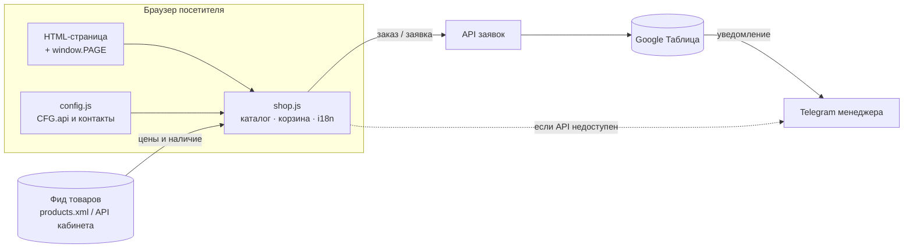

<div align="center">


# Samostroy Shop

**Інтернет-магазин матеріалів для ремонту своїми руками + партнерська платформа: дропшипінг, опт, постачальники, академія**

[](https://samostroy.shop)
[](LICENSE)
[](LICENSE)
[](#-права-и-использование-кода)

[](#-технологии)
[](#-деплой)
[](#-мультиязычность-ua--ru)
[](#-быстрый-старт-для-владельцев-и-команды)

[Сайт](https://samostroy.shop) · [Дропшипінг](https://samostroy.shop/dropshipping.html) · [Партнерський кабінет](https://samostroy.shop/partners.html) · [Постачальникам](https://samostroy.shop/postachalniky.html) · [Telegram](https://t.me/samostroy_shop)


</div>

---

> # ⛔ ВНИМАНИЕ: ПРОПРИЕТАРНЫЙ ПРОЕКТ — КОПИРОВАНИЕ И ИСПОЛЬЗОВАНИЕ КОДА ЗАПРЕЩЕНЫ
>
> Это **коммерческий проект магазина Samostroy Shop**. Репозиторий открыт для просмотра **только для хостинга сайта**. Он **не является open source**.
>
> **Запрещено без письменного разрешения владельца:** копировать, клонировать, форкать для переиспользования, изменять, переделывать, публиковать, продавать и использовать любой код, верстку, дизайн, тексты, изображения и другие материалы этого репозитория — полностью или частично, в коммерческих и некоммерческих целях. Запрещено использовать материалы для обучения ИИ-моделей и массово собирать их скрейпингом.
>
> Нарушение влечёт ответственность по законодательству Украины и международным нормам, а также жалобы (в том числе DMCA) на хостинг, платформы и регистраторов доменов.
>
> 📄 Полный текст: [**LICENSE**](LICENSE) · Разрешение: [partner@samostroy.shop](mailto:partner@samostroy.shop) · [Telegram](https://t.me/manager_samostroy_shop)

---

## 📑 Содержание

1. [Права и использование кода](#-права-и-использование-кода)
2. [О проекте](#-о-проекте)
3. [Возможности](#-возможности)
4. [Карта страниц](#-карта-страниц)
5. [Технологии](#-технологии)
6. [Структура репозитория](#-структура-репозитория)
7. [Архитектура и потоки данных](#-архитектура-и-потоки-данных)
8. [Быстрый старт для владельцев и команды](#-быстрый-старт-для-владельцев-и-команды)
9. [Конфигурация](#-конфигурация)
10. [Каркас страницы и объект `window.PAGE`](#-каркас-страницы-и-объект-windowpage)
11. [Как добавить новую страницу](#-как-добавить-новую-страницу)
12. [Дизайн-система](#-дизайн-система)
13. [Мультиязычность (UA / RU)](#-мультиязычность-ua--ru)
14. [Формы и заявки](#-формы-и-заявки)
15. [Партнерская программа](#-партнерская-программа)
16. [Академия и блог](#-академия-и-блог)
17. [SEO и микроразметка](#-seo-и-микроразметка)
18. [Производительность, доступность, браузеры](#-производительность-доступность-браузеры)
19. [Безопасность](#-безопасность)
20. [Деплой](#-деплой)
21. [Правила работы команды](#-правила-работы-команды)
22. [Чеклист перед коммитом](#-чеклист-перед-коммитом)
23. [Защита прав и реагирование на нарушения](#-защита-прав-и-реагирование-на-нарушения)
24. [FAQ и частые проблемы](#-faq-и-частые-проблемы)
25. [Сторонние компоненты](#-сторонние-компоненты)
26. [Roadmap](#-roadmap)
27. [Контакты](#-контакты)
28. [Лицензия и авторские права](#-лицензия-и-авторские-права)

---

## ⚖️ Права и использование кода

© 2019–2026 **Samostroy Shop**. Все права защищены.

Код, верстка, структура и дизайн сайта, дизайн-система, тексты, описания товаров, фотографии, логотипы, материалы Samostroy Academy, статьи блога, фиды и документация — **интеллектуальная собственность Samostroy Shop**.

### Что можно и нельзя

| Действие | Статус |
|---|---|
| Просматривать сайт и репозиторий для ознакомления | ✅ Разрешено |
| Пользоваться сайтом [samostroy.shop](https://samostroy.shop) как покупатель | ✅ Разрешено |
| Индексация страниц поисковыми системами по `robots.txt` | ✅ Разрешено |
| Партнёрам: использовать фото и описания **наших товаров** для продажи **наших товаров** по правилам партнёрской программы | ✅ Разрешено |
| Копировать, клонировать, форкать для использования, скачивать для переиспользования | ⛔ Запрещено |
| Использовать код, верстку, стили, скрипты, компоненты в своих проектах | ⛔ Запрещено |
| Делать клоны, «похожие» сайты, шаблоны, темы, переводы или рерайты нашего сайта | ⛔ Запрещено |
| Продавать, раздавать, публиковать, сдавать в аренду материалы | ⛔ Запрещено |
| Использовать для обучения и оценки ИИ-моделей, включать в датасеты | ⛔ Запрещено |
| Массовый скрейпинг и автоматическое скачивание | ⛔ Запрещено |
| Удалять или менять уведомления об авторских правах, логотипы, названия | ⛔ Запрещено |
| Использовать название, домен, логотип так, что вводит в заблуждение | ⛔ Запрещено |
| Использовать найденные в коде адреса, ключи и идентификаторы сервисов в иных целях | ⛔ Запрещено |
| Любое иное использование | 📝 Только по письменному договору |

### Как получить разрешение

Напишите на [partner@samostroy.shop](mailto:partner@samostroy.shop) или в [Telegram](https://t.me/manager_samostroy_shop). Укажите, **что именно** вы хотите использовать, **для чего** и **на какой срок**. Использование возможно только после подписания письменного соглашения.

> ℹ️ Публичный доступ к репозиторию **не означает** согласия на использование материалов. Полный юридический текст — в файле [LICENSE](LICENSE).

---

## 🏗 О проекте

**Samostroy Shop** — украинский интернет-магазин самоклеящихся материалов для ремонта своими руками. Ассортимент — **1200+ позиций**:

- 3D-панели, стеновые панели, 3D-рейки
- PET-, виниловая, алюминиевая, полиуретановая, LVT, композитная и ПВХ-плитка
- самоклеящаяся плёнка, обои, тёплые обои, штукатурка
- пол-пазл, виниловые покрытия, коврики, термо- и влагопоглощающие коврики
- экокожа, зеркальный декор, акриловые зеркала
- мебель (надувная, складная, стеллажи), контейнеры, плинтусы и профили

Репозиторий — **фронтенд сайта [samostroy.shop](https://samostroy.shop)**: витрина с каталогом и корзиной, лендинги для бизнеса и партнёров, обучающая платформа Samostroy Academy и блог. Проект — статический сайт без сборки.

| Аудитория | Что получает | Страница |
|---|---|---|
| Покупатели | Каталог, подбор, корзина, заказ менеджеру | `index.html` и подборки |
| Оптовые покупатели | Оптовые условия | `opt.html` |
| Дропшипперы | Программа без склада и вложений, 3 уровня | `dropshipping.html`, `partners.html` |
| Поставщики и производители | Размещение товаров, маркетинг, логистика | `postachalniky.html` |
| Партнёры-франчайзи | Условия франшизы | `franchise.html` |
| Кандидаты | Вакансии | `jobs.html`, `jobs-drop.html` |
| Ученики | Курсы и обучение | `academy.html`, `course-*.html` |

---

## ✨ Возможности

### Витрина
- Каталог с категориями и группами (`?c=<категория>`, `?g=<группа>`), поиск по названию, артикулу и цвету
- Мега-меню «Каталог», быстрый поиск, подбор товара (квиз)
- Карточка товара в модальном окне (`<dialog>`), корзина-drawer
- Оформление заказа: имя, телефон, город и отделение почты, оплата (при получении / на карту), доставка (Нова Пошта / Укрпошта)
- Отправка заказа менеджеру через API с запасным каналом — Telegram
- Подборки-лендинги: винил, пол-пазл, коврики, экокожа, зеркала, мебель

### Для партнёров
- **Партнёрский кабинет** (`partners.html`): 1000+ товаров с актуальной ценой и наличием, расчёт дохода, уровни Starter ≈10% и Pro ≈15%, ползунок собственной наценки
- Готовые тексты объявлений без HTML, ссылки на фото, «Мой список» (хранится в браузере)
- Экспорт в CSV, копирование всех текстов, отправка списка менеджеру в Telegram
- Шаблоны ответов клиентам и список площадок (OLX, Besplatka, Obyava, Prom, Rozetka, Facebook Marketplace, Instagram, TikTok)
- **Калькулятор дохода** на странице дропшипинга
- Формы заявки на партнёрство и заявки поставщика

### Обучение и контент
- **Samostroy Academy** — курсы: дропшипинг, продажи, масштабирование, лидерство, саморазвитие, «Миллион 100», «Learn 60», «Change or Die»
- Блог на `blog.json` с отдельными `blog.html / blog.css / blog.js`

### Платформа
- Две языковые версии UA / RU
- Адаптив: десктоп, планшет, мобильная нижняя панель навигации
- Плавающая кнопка связи (Telegram / Viber / звонок)
- SEO-база: canonical, Open Graph, JSON-LD, sitemap, robots

---

## 🗺 Карта страниц

| Группа | Файлы |
|---|---|
| **Магазин** | `index.html` |
| **Подборки** | `vinil.html`, `pazl-pidloga.html`, `kylimky.html`, `ekoshkira.html`, `dzerkala.html`, `mebli.html` |
| **Сотрудничество** | `opt.html`, `dropshipping.html`, `partners.html`, `partner-cabinet.html`, `postachalniky.html`, `franchise.html` |
| **Бизнес и люди** | `business.html`, `bio.html`, `jobs.html`, `jobs-drop.html`, `lk.html` |
| **Дроп-страницы** | `drop.html`, `fooldrop.html`, `modulus.html` |
| **Академия** | `academy.html`, `course-dropshipping.html`, `course-sales3.html`, `course-scale.html`, `course_scale_up.html`, `course-leadership.html`, `course-selfgrowth.html`, `course-million100.html`, `course-learn60.html`, `course-change-or-die.html` |
| **Блог** | `blog.html`, `blog.json` |
| **Служебные** | `sitemap.xml`, `robots.txt`, `products.xml`, `CNAME`, `LICENSE`, `SECURITY.md` |

---

## 🧰 Технологии

| Слой | Что используется |
|---|---|
| Разметка | Семантический HTML5, `<dialog>`, `<details>`, SVG-спрайт (`<symbol>` + `<use>`) |
| Стили | Чистый CSS, общий `shop.css`, страничные файлы (`partners.css`, `academy.css`, `blog.css` и др.), CSS-переменные |
| Скрипты | Vanilla JS без фреймворков: `shop.js` (ядро магазина), `config.js`, `partners.js`, `academy.js`, `blog.js` и др. |
| Шрифты | Google Fonts: **Golos Text** (текст), **Unbounded** (заголовки) |
| Данные | `products.xml` (фид), `blog.json`, внешний API кабинета (dropoffice) |
| Заявки | API → Google Таблица (+ уведомление менеджеру в Telegram), запасной канал — Telegram |
| Хостинг | GitHub Pages + домен через `CNAME` |
| Сборка | Не требуется |

**Принципы:** никакой сборки, минимум зависимостей, быстрая загрузка, каждая страница — самостоятельный HTML-файл поверх общего каркаса.

---

## 📂 Структура репозитория

```text
stroyshopua/
├── LICENSE                     # Проприетарная лицензия (UA + EN)
├── SECURITY.md                 # Политика безопасности
├── README.md
├── CNAME                       # Домен для GitHub Pages
├── robots.txt · sitemap.xml · products.xml
├── index.html                  # Главная и каталог
│
├── shop.css / shop.js          # Общий каркас магазина: шапка, каталог, корзина, футер
├── config.js                   # Конфигурация (API, контакты)
├── partners.css / partners.js  # Партнёрский кабинет
├── style.css / script.js / app.js   # Более ранние общие стили и скрипты
│
├── dropshipping.html           # Программа дропшипинга + калькулятор + заявка
├── partners.html               # Партнёрский кабинет (каталог для дропшипперов)
├── partner-cabinet.html
├── postachalniky.html          # Страница для поставщиков
├── opt.html · franchise.html · jobs.html · jobs-drop.html · business.html · bio.html · lk.html
│
├── vinil.html · pazl-pidloga.html · kylimky.html · ekoshkira.html · dzerkala.html · mebli.html
│
├── academy.html / .css / .js   # Samostroy Academy
├── course-*.html · course_scale_up.html
├── change-or-die.* · leadership.* · learn60.* · million100.* · scale.* · selfgrowth.*
│   course-sales3.* · course-dropshipping.*       # Курсы
│
├── blog.html / .css / .js / .json
│
├── cd/                         # Вспомогательная папка
├── tools/                      # Инструменты
│
└── *.jpg / *.png               # logo.jpg, favicon.png, samostroy-preview.jpg, DropSamostroyShop.jpg и др.
```

---

## 🔄 Архитектура и потоки данных



**Поток заказа / заявки:**

1. Пользователь заполняет форму (корзина, заявка партнёра или поставщика).
2. Скрипт валидирует телефон (`phoneOk`) и проверяет honeypot-поле (`.hp`).
3. Если задан `CFG.api` — данные уходят в API (`api({action:'order', order:{…}})`) с идемпотентным ключом (`okey()`), заявка попадает в Google Таблицу, менеджер получает уведомление.
4. Если API не настроен или запрос не удался — пользователю предлагается отправить готовый текст в Telegram (`tg(msg)`).

**Глобальные помощники** (в `shop.js` / `config.js`): `CFG`, `api`, `tg`, `phoneOk`, `okey`, `leadItems`, `esc`, `lang`.

---

## 🚀 Быстрый старт для владельцев и команды

> Раздел предназначен для сотрудников и подрядчиков, **работающих по договору с Samostroy Shop**. Для остальных клонирование и использование кода запрещено — см. [Права и использование кода](#-права-и-использование-кода).

Сборка не нужна — достаточно любого статического сервера. Открывать файлы через `file://` не рекомендуется.

```bash
git clone https://github.com/Dev-Geniy/stroyshopua.git
cd stroyshopua

# любой вариант:
python3 -m http.server 8080
npx serve .
php -S localhost:8080

# http://localhost:8080
```

**Требования:** современный браузер и один из: Python 3, Node.js или PHP.

---

## ⚙️ Конфигурация

Основные настройки — в `config.js` (подключается: `<script src="config.js?v=…">`).

| Параметр | Назначение |
|---|---|
| `CFG.api` | URL API для заказов и заявок. Если пусто — заявки уходят только в Telegram |
| Контакты | Telegram менеджера, Viber, телефон |

**Контакты в разметке:**

| Что | Значение |
|---|---|
| Телефон | `+380 98 492 79 48` |
| Telegram менеджера | [`@manager_samostroy_shop`](https://t.me/manager_samostroy_shop) |
| Telegram-канал | [`@samostroy_shop`](https://t.me/samostroy_shop) |
| Instagram | [`samostroy.shop`](https://www.instagram.com/samostroy.shop) |
| TikTok | [`@stroyshop_ua`](https://www.tiktok.com/@stroyshop_ua) |
| Email | `partner@samostroy.shop` |

**Кэш-бастинг.** Ассеты версионируются query-строкой: `shop.css?v=9572495d`. После изменения файла обновите хэш **во всех** страницах, где он подключён.

> 🔐 Не храните в репозитории приватные ключи, токены и пароли. Всё, что лежит в клиентском JS, видно любому посетителю сайта.

---

## 🧩 Каркас страницы и объект `window.PAGE`

```text
<head>   мета, canonical, Open Graph, JSON-LD, шрифты, shop.css [+ страничный css]
<body>
  SVG-спрайт иконок
  <header>   логотип · «Каталог» · поиск · телефон · UA/RU · корзина · мега-меню
  <main>     контент страницы (секции .w .sec …)
  <footer>   колонки: Каталог / Добірки / Співпраця + соцсети
  <nav.mbar> нижняя мобильная навигация
  .fab       плавающая кнопка связи
  <aside#cart>   корзина с формой заказа
  <dialog#pd>    карточка товара
  #toast         уведомления
  <script src="config.js">
  <script>window.PAGE = {…}</script>
  <script src="shop.js">  [+ страничный js]
```

`shop.js` читает настройки страницы из **`window.PAGE`**:

| Поле | Тип | Назначение |
|---|---|---|
| `cats` | `string[]` | Слаги категорий, доступных на странице |
| `name` | `string` | Название страницы |
| `listTitle` | `string` | Заголовок списка товаров |
| `url` | `string` | Канонический URL |
| `title` | `string` | Заголовок (как в `<title>`) |
| `desc` | `string` | Описание (как в `meta description`) |
| `guide` | `string` | Текст-гайд для подборок (пусто, если не нужен) |
| `calc` | `0 / 1` | Блок расчёта количества |
| `faq` | `[вопрос, ответ][]` | Вопросы-ответы для микроразметки FAQ |
| `wall` | `string[]` | Категории для «стены» плиток в hero (дропшипинг) |
| `info` | `boolean` | Информационная страница |

Категории из `cats`: `3d-paneli`, `stinovi-paneli`, `3d-reyky`, `pet-plytka`, `pet-plytka-rulon`, `pet-mozayika`, `plytka-vinilova`, `pvh-plytka`, `lvt-plytka`, `kompozytna-plytka`, `poliuretanova-plytka`, `plytka-pid-kovrolin`, `alyuminiyeva-plytka`, `mozayika-sklo`, `samokleyucha-plivka`, `shpalery`, `tepli-shpalery`, `shtukaturka`, `pidloga-pazl`, `pidloga-pazl-plyushevyy`, `pidlogove-vinilove-pokryttya`, `termokylymky`, `vologopoglynayuchi-kylymky`, `ekoshkira`, `dzerkalnyi-dekor`, `akrylovi-dzerkala`, `plintusy`, `profili-dekor`, `pvh-paneli-plyty`, `manikyur`, `konteynery`, `naduvni-mebli`, `stelazhi`, `skladni-mebli`.

### Атрибуты-хуки

| Атрибут | Назначение |
|---|---|
| `data-a="…"` | Действия по клику: `mega`, `cart`, `close`, `msearch`, `quiz`, `fab`, `order`, `clr`, `tocat`, `clearcart`, `pdclose`, `seo` |
| `data-i="ключ"` | Перевод текста |
| `data-ip="ключ"` | Перевод `placeholder` |
| `data-l="uk\|ru"` | Переключатель языка |
| `data-cnt` | Счётчик корзины |
| `data-dir` | Контейнер мега-меню |
| `data-avn` | Количество товаров в наличии |
| `data-lvl` | Передача выбранного уровня партнёра в форму |

---

## ➕ Как добавить новую страницу

1. **Возьмите ближайший шаблон:** лендинг → `dropshipping.html` / `postachalniky.html`; подборка → `vinil.html`, `kylimky.html`; инструмент с каталогом → `partners.html`.
2. **Обновите `<head>`:** `title`, `description`, `canonical`, `og:*`, `twitter:*`.
3. **Измените `window.PAGE`:** `name`, `listTitle`, `url`, `title`, `desc`, `faq`, `cats`.
4. **Замените содержимое `<main>`** блоками дизайн-системы. Шапку, футер, корзину и мобильную панель не меняйте.
5. **Добавьте ссылки:** в футер всех страниц и в `sitemap.xml`.
6. **Форма:** блок `.apply` + `.af`, обработчик из `dropshipping.html` / `postachalniky.html`, поменяйте `order.type`.
7. **Добавьте уведомление об авторских правах** (см. [Защита прав](#-защита-прав-и-реагирование-на-нарушения)).
8. Пройдите [чеклист](#-чеклист-перед-коммитом).

---

## 🎨 Дизайн-система

Задаётся `shop.css`. Цвет темы — `#2b3138`. Шрифты: **Unbounded** (заголовки, цифры) и **Golos Text** (текст).

| Класс | Назначение |
|---|---|
| `.w` | Контейнер с ограничением ширины |
| `.hero` (+ `.lhero`) | Первый экран: `crumbs`, `h1`, `.lead`, `.acts`, `.facts` |
| `.sec` | Секция с `h2` |
| `.crumbs` | Хлебные крошки |
| `.facts` | Ряд ключевых фактов |
| `.btn`, `.btn.ghost`, `.btn.sm` | Кнопки |
| `.link` | Кнопка-ссылка |
| `.box`, `.box.we` | Карточка; `.we` выделяет сторону «Мы» |
| `.split` | Две карточки рядом |
| `.aud` | Три карточки-аудитории с `.chips` |
| `.chan` | Сетка пунктов `b` + `span` + `em` |
| `.flow` | Пошаговый процесс; `.who`, `.who.we` |
| `.levels` / `.lvl` / `.lvl.mid` | Уровни партнёра |
| `.cmp` / `.cmpw` | Сравнительная таблица |
| `.inc` | Калькулятор дохода |
| `.apply` + `.af` | Заявка: шаги слева, форма справа; `.tgl`, `.hint`, `.done` |
| `.faq` | Аккордеон на `<details>` |
| `.seo` + `.txt.cut` | SEO-текст со сворачиванием |
| `.acad` | Блок анонса академии |
| `.sk` | Скелетон загрузки |
| `.hp` | Honeypot-поле (скрыто) |

**Иконки** — SVG-спрайт в начале `<body>`:

```html
<svg class="i"><use href="#i-check"/></svg>
```

Доступны: `i-search`, `i-cart`, `i-grid`, `i-x`, `i-chat`, `i-check`, `i-ruler`, `i-quiz`, `i-tg`.

**Типографика:** типографский апостроф `’` в украинском тексте; кнопки и заголовки — в sentence case.

---

## 🌐 Мультиязычность (UA / RU)

- Основной язык — украинский (`<html lang="uk">`), второй — русский.
- Переключатель `UA | RU` в шапке (`[data-l]`), выбор запоминается.
- Тексты каркаса переводятся по ключам `data-i` и `data-ip`.
- Контент лендингов пишется на украинском прямо в HTML.

**Добавление перевода:** добавьте ключ в словарь в `shop.js`, затем поставьте `data-i="ключ"` на элемент.

---

## 📬 Формы и заявки

| Форма | Страница | Тип | Поля |
|---|---|---|---|
| Заказ | Корзина | заказ | имя, телефон, город и отделение, оплата, доставка |
| Партнёрство | `dropshipping.html` | `Дропшипінг` | имя, телефон, Telegram/Viber, каналы, опыт, уровень, комментарий |
| Поставщик | `postachalniky.html` | `Постачальник` | компания, контактное лицо, телефон, email/Telegram, тип, формат, комментарий |

**Защита и надёжность:** проверка телефона, honeypot `.hp`, индикатор отправки `.busy`, идемпотентный ключ `okey()`, запасной канал — Telegram.

> Персональные данные заявителей (имя, телефон) обрабатываются только для связи по заявке. Не выгружайте их в репозиторий и не показывайте публично.

---

## 🤝 Партнерская программа

### Дропшипинг

Партнёр находит покупателей (OLX, Prom, Rozetka, соцсети, свой сайт), склад, упаковку, отправку, обмен и возврат берёт на себя Samostroy Shop. Прибыль партнёра — разница между его ценой и оптовой.

| Уровень | Для кого | Условие | Маржа |
|---|---|---|---|
| **Starter** | Новички | Без минимального оборота | в среднем до ≈10% |
| **Pro** | Магазины и продавцы с заказами каждую неделю | Оборот от 20 000–30 000 ₴ в месяц | от ≈15% |
| **Team** | Несколько каналов или команда | Оборот от 80 000–100 000 ₴ в месяц | лучшие цены и бонусы с оборота |

### Поставщики

Страница `postachalniky.html`: размещение товаров производителей, оптовых баз и новых брендов. Форматы: опт, дропшипинг, смешанный. Минимальный объём и эксклюзив обсуждаются индивидуально. Требования: качество, контент по товарам, документы, работа с возвратами.

### Что получает партнёр

Готовые фото и описания **для продажи наших товаров**, партнёрский кабинет, шаблоны объявлений и ответов, обучение в Samostroy Academy, поддержку менеджера в Telegram.

> Права партнёра ограничены контентом товаров и целью продажи товаров Samostroy Shop. Код, верстка и дизайн сайта партнёрам **не передаются** — см. [LICENSE](LICENSE), п. 3.3.

---

## 🎓 Академия и блог

**Samostroy Academy** (`academy.html`) — обучающая платформа для партнёров. Курс «Дропшипінг з нуля» бесплатен для уровня Starter. Остальные курсы — отдельные страницы `course-*.html`. Материалы курсов защищены авторским правом и не подлежат перепубликации.

**Блог** (`blog.html`) — статьи в `blog.json`, отрисовка `blog.js`, оформление `blog.css`. Чтобы добавить статью, добавьте запись в `blog.json` по формату существующих.

---

## 🔎 SEO и микроразметка

На каждой странице:

- уникальные `<title>` и `meta description`, `robots: index,follow,max-image-preview:large`
- `canonical` на собственный URL
- Open Graph и Twitter Card
- JSON-LD: `OnlineStore` и `WebSite` (с `SearchAction`), блок `#ld` заполняется скриптом
- `theme-color`, favicon, `apple-touch-icon`

Файлы индексации: `sitemap.xml`, `robots.txt`. Новую страницу всегда добавляйте в `sitemap.xml`.

---

## ⚡ Производительность, доступность, браузеры

**Производительность**
- нет сборки и фреймворков, общий кэшируемый `shop.css` / `shop.js`
- `preconnect` к Google Fonts и API кабинета
- скелетоны (`.sk`) вместо пустого экрана при загрузке каталога
- изображения с заданными `width` / `height`, чтобы не прыгала вёрстка

**Доступность**
- семантические теги, `aria-label` на кнопках-иконках, `aria-expanded` у меню, `aria-live` у динамических блоков
- `<details>` для FAQ, `<dialog>` для карточки товара
- видимые состояния фокуса и подсказки ошибок в формах

**Поддержка браузеров:** актуальные версии Chrome, Firefox, Safari, Edge (десктоп и мобильные).

---

## 🔐 Безопасность

- В клиентском коде нет и не должно быть секретов: токены, пароли и ключи с правами записи запрещены.
- Все пользовательские значения, выводимые в HTML, экранируются функцией `esc()`.
- Формы защищены honeypot-полем и серверной валидацией на стороне API.
- Об уязвимостях сообщайте приватно по [SECURITY.md](SECURITY.md). Не создавайте публичные Issue.
- Репозиторий публичный: всё, что в нём лежит, считается видимым любому. Если нужно скрыть исходники физически, переведите репозиторий в **Private** (см. [Защита прав](#-защита-прав-и-реагирование-на-нарушения)).

---

## 🌍 Деплой

Сайт публикуется на **GitHub Pages**, домен привязан файлом `CNAME`.

1. **Settings → Pages →** ветка `main`, папка `/ (root)`.
2. В DNS домена настройте записи на GitHub Pages (A-записи на IP GitHub или CNAME на `<user>.github.io`).
3. Включите **Enforce HTTPS**.
4. Push в `main` публикуется автоматически (обычно 1–2 минуты).

> Файл `CNAME` не удаляйте и не переименовывайте — домен отвяжется.

---

## 👥 Правила работы команды

**Ветки:** `main` — рабочая версия сайта. Изменения делайте в отдельных ветках `feature/<описание>` или `fix/<описание>` и вливайте через Pull Request.

**Коммиты** (формат Conventional Commits):

```text
feat: добавить страницу поставщиков
fix: исправить расчёт дохода в калькуляторе
content: обновить тексты FAQ дропшипинга
style: выровнять карточки аудитории
seo: добавить страницу в sitemap
docs: обновить README
```

**Внешние контрибьюции не принимаются.** Pull Request и Issue от посторонних лиц могут быть закрыты без рассмотрения: передача кода в репозиторий не создаёт у автора прав на проект. Работа ведётся только сотрудниками и подрядчиками по договору, в котором права на результат закреплены за Samostroy Shop.

---

## ✅ Чеклист перед коммитом

- [ ] Страница открывается через локальный сервер, нет ошибок в консоли
- [ ] Адаптив: 360 px, 768 px, 1280 px
- [ ] `title`, `description`, `canonical`, `og:*` уникальны и корректны
- [ ] `window.PAGE` заполнен, `url` совпадает с `canonical`
- [ ] Ссылки в футере и меню ведут на существующие файлы
- [ ] Страница добавлена в `sitemap.xml`
- [ ] Хэши версий (`?v=…`) обновлены, если менялись общие CSS/JS
- [ ] Формы: проверен успешный путь и запасной (Telegram)
- [ ] Картинки с `alt`, размеры `width`/`height` заданы
- [ ] В коде нет секретов и персональных данных клиентов
- [ ] Добавлено уведомление об авторских правах в новый файл
- [ ] Тексты проверены, телефоны и ссылки на мессенджеры актуальны

---

## 🛡 Защита прав и реагирование на нарушения

### Что уже сделано
- Файл [`LICENSE`](LICENSE) с запретом копирования и использования (UA + EN)
- Заметное предупреждение в начале этого README
- Политика [`SECURITY.md`](SECURITY.md)

### Рекомендуемые меры (добавить в проект)

**1. Уведомление в каждом HTML-файле** (сразу после `<!DOCTYPE html>`):

```html
<!--
  © 2019-2026 Samostroy Shop. All rights reserved.
  Proprietary code. Copying, reuse and AI-training prohibited without written permission.
  Власний код. Копіювання й використання заборонено без письмового дозволу.
  https://samostroy.shop · partner@samostroy.shop
-->
```

**2. Мета-тег** в `<head>`:

```html
<meta name="copyright" content="© 2019-2026 Samostroy Shop. All rights reserved.">
```

**3. Шапка в CSS и JS** (первая строка файла):

```text
/*! © 2019-2026 Samostroy Shop. All rights reserved. Proprietary. https://samostroy.shop */
```

**4. `robots.txt`** — закрыть известных ИИ-краулеров (это просьба, а не защита; соблюдают её только добросовестные боты):

```text
User-agent: GPTBot
Disallow: /

User-agent: CCBot
Disallow: /

User-agent: Google-Extended
Disallow: /

User-agent: anthropic-ai
Disallow: /

User-agent: ClaudeBot
Disallow: /

User-agent: *
Allow: /
Sitemap: https://samostroy.shop/sitemap.xml
```

**5. Приватность репозитория.** Публичный репозиторий на GitHub доступен всем, и по правилам платформы другие пользователи могут его просматривать и форкать. Лицензия даёт **юридическое** основание требовать удаления, но не мешает скачать код технически. Для сайтов на GitHub Pages код в любом случае отдаётся браузеру посетителя (HTML/CSS/JS видны через «Просмотр кода»). Максимальная защита исходников: частный репозиторий (для Pages на частных репозиториях нужен платный план GitHub) или хостинг сайта вне GitHub.

### Если вы нашли копию нашего сайта или кода

1. Сохраните доказательства: URL, скриншоты, дата, архив страницы.
2. Подайте жалобу хостинг-провайдеру и регистратору домена (WHOIS).
3. Для копий на GitHub — [форма DMCA](https://github.com/contact/dmca) и указание на файл `LICENSE`.
4. Сообщите нам: [partner@samostroy.shop](mailto:partner@samostroy.shop) / [Telegram](https://t.me/manager_samostroy_shop).
5. При необходимости обратитесь к юристу по интеллектуальной собственности.

---

## ❓ FAQ и частые проблемы

**Можно ли взять наш дизайн/код для своего магазина?**
Нет. Только по письменному договору с Samostroy Shop. См. [Права и использование кода](#-права-и-использование-кода).

**Я партнёр. Могу ли использовать фото и описания товаров?**
Да, для продажи товаров Samostroy Shop по правилам партнёрской программы. Код и верстка сайта сюда не входят.

**Страница выглядит «сломанной» после правки CSS.**
Браузер держит старый кэш. Обновите хэш `?v=…` у `shop.css` / страничного CSS на всех страницах.

**Форма не отправляет заявку.**
Проверьте `CFG.api` в `config.js` и консоль браузера. Если API недоступен, форма предлагает запасную отправку в Telegram.

**Не открывается с `file://` или не грузятся данные.**
Запускайте через локальный сервер (`python3 -m http.server`).

**Страница не появляется в поиске.**
Проверьте `canonical`, `robots`, наличие страницы в `sitemap.xml`.

**Домен слетел после деплоя.**
Убедитесь, что файл `CNAME` на месте и в Settings → Pages указан правильный домен.

**Где перевод для нового текста в корзине или меню?**
В словаре переводов в `shop.js`; на элементе используется `data-i="ключ"`.

---

## 📦 Сторонние компоненты

На сторонние компоненты проприетарная лицензия проекта **не распространяется**:

| Компонент | Лицензия |
|---|---|
| Golos Text (Google Fonts) | SIL Open Font License 1.1 |
| Unbounded (Google Fonts) | SIL Open Font License 1.1 |
| Названия и логотипы OLX, Prom, Rozetka, Facebook, Instagram, TikTok, Telegram, Viber, Нова Пошта, Укрпошта, Google | принадлежат их владельцам, упоминаются для информации |
| Торговые марки производителей товаров | принадлежат производителям |

---

## 🧭 Roadmap

- [ ] Вынести общий каркас (шапка, футер, корзина) в один компонент вместо дублирования в каждом HTML
- [ ] Добавить авторские уведомления во все HTML/CSS/JS-файлы
- [ ] Закрыть ИИ-краулеров в `robots.txt`
- [ ] Автоматическая проверка ссылок и `sitemap.xml` через GitHub Actions
- [ ] Автогенерация `sitemap.xml` из списка страниц
- [ ] Свести `style.css` / `script.js` / `app.js` к единой системе стилей
- [ ] Полный русский перевод лендингов
- [ ] Импорт товаров на маркетплейсы из партнёрского кабинета
- [ ] Рассмотреть перевод репозитория в Private и/или минификацию продакшн-ассетов

---

## 📞 Контакты

| | |
|---|---|
| 🌐 Сайт | [samostroy.shop](https://samostroy.shop) |
| 📞 Телефон | [+380 98 492 79 48](tel:+380984927948) |
| 💬 Менеджер | [@manager_samostroy_shop](https://t.me/manager_samostroy_shop) |
| 📣 Канал | [@samostroy_shop](https://t.me/samostroy_shop) |
| 📸 Instagram | [samostroy.shop](https://www.instagram.com/samostroy.shop) |
| 🎵 TikTok | [@stroyshop_ua](https://www.tiktok.com/@stroyshop_ua) |
| ✉️ Лицензирование, поставщики, безопасность | [partner@samostroy.shop](mailto:partner@samostroy.shop) |

---

## 📄 Лицензия и авторские права

**© 2019–2026 Samostroy Shop. Все права защищены.**

Проект распространяется по **проприетарной лицензии** ([LICENSE](LICENSE)). Это **не** открытое программное обеспечение. Любое копирование, воспроизведение, модификация, распространение и иное использование кода, дизайна, текстов, изображений и других материалов без **письменного разрешения** правообладателя **запрещены**.

Сторонние компоненты и товарные знаки принадлежат их владельцам.

<div align="center">

Сделано в Украине 🇺🇦 командой Samostroy Shop

</div>
